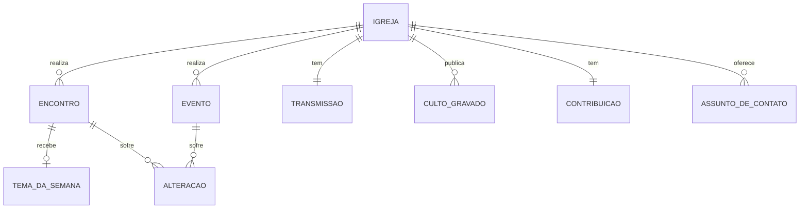

# Modelo de dados

O conteúdo que o site publica para o app e o formato dos arquivos do repositório que o servidor do app lê. O significado de cada entidade e as regras que valem sempre estão no `docs/DATA-MODEL.md` do repositório do app (DomdeAmarApp). Este documento fixa os nomes das chaves, os tipos e os valores permitidos. Atualize-o no mesmo PR que mudar o que ele descreve; uma mudança aqui muda um contrato público (ver `docs/adr/0001-contrato-versionado-em-api-v1.md`).

## Convenções

- Datas no formato `AAAA-MM-DD` e horas no formato `HH:MM`, no horário de Brasília.
- Um dado ausente é `null`, nunca `""`.
- Chaves em camelCase, em pt-BR.
- `provisorio: true` marca conteúdo que ainda não é definitivo. O app não o mostra e não avisa sobre ele.
- Vídeo: `{ plataforma: "facebook" | "youtube", endereco: string }`. O endereço é o endereço público daquele vídeo na plataforma. Plataforma e endereço andam sempre juntos.

## Conteúdo publicado

Endereço oficial: `https://domdeamar.vercel.app/api/v1/<coleção>.json`.



| Coleção               | Forma                                     | Campos                                                                                                                                                                                                                                                                       |
| --------------------- | ----------------------------------------- | ---------------------------------------------------------------------------------------------------------------------------------------------------------------------------------------------------------------------------------------------------------------------------- |
| `igreja`              | objeto                                    | `nome`; `endereco { rua, bairro, cidade, uf, cep, referencia\|null }`; `whatsapp` (só dígitos, com código do país) \| `null`; `redes { facebook\|null, youtube\|null }`                                                                                                      |
| `encontros`           | lista                                     | `id`; `nome`; `nomeCurto`\|`null`; `descricao`; `diaSemana` (inteiro, 0 = domingo a 6 = sábado); `hora`; `ocorrencia` (`"semanal"`, `"1"`, `"2"`, `"3"`, `"4"` ou `"ultima"`); `substituiODia`; `duracaoMin` (inteiro, 120 quando não informado); `recebeTema`; `provisorio` |
| `eventos`             | lista                                     | `id`; `titulo`; `descricao`; `local`; `data`; `hora`; `provisorio`                                                                                                                                                                                                           |
| `tema-da-semana`      | objeto                                    | `data`; `tema`; `textoBiblico`\|`null`; `pregador`; `provisorio`                                                                                                                                                                                                             |
| `alteracoes`          | lista                                     | `id`; `alvo` (id de um encontro ou evento); `data`; `situacao` (`"cancelado"` ou `"alterado"`); `novaHora`\|`null`; `novoLocal`\|`null`; `mensagem`; `avisar`                                                                                                                |
| `transmissao`         | objeto                                    | `aoVivo`; `data`\|`null`; `video`\|`null`                                                                                                                                                                                                                                    |
| `cultos-gravados`     | lista, do mais recente para o mais antigo | `id`; `titulo`; `textoBiblico`\|`null`; `pregador`\|`null`; `data`; `video`; `provisorio`                                                                                                                                                                                    |
| `contribuicao`        | objeto                                    | `pix { chave, tipo, titular }`\|`null`; `transferencia { banco, agencia, conta }`\|`null`                                                                                                                                                                                    |
| `assuntos-de-contato` | lista                                     | `id`; `titulo`; `rotulo`; `mensagem`                                                                                                                                                                                                                                         |

## Regras que o site garante ao publicar

1. Os identificadores de encontros e eventos não se repetem entre si. Se repetirem, o build falha.
2. Uma alteração publicada aponta para um encontro ou evento existente, numa data em que ele ocorre. Há no máximo uma por alvo e data (entre duas, fica a primeira na ordem do painel), e uma alteração `"alterado"` tem `novaHora`, `novoLocal` ou os dois. A `mensagem` não é vazia e a `novaHora`, quando existe, está em `HH:MM`. Uma alteração que não cumpre isso fica fora da publicação, com alerta no build.
3. Um culto gravado publicado tem vídeo válido. Uma transmissão com vídeo inválido é publicada com `video: null`. Os dois casos geram alerta no build.
4. `whatsapp` é `null` enquanto o contato da igreja estiver marcado como provisório.
5. Em `contribuicao`, `pix` é `null` enquanto não houver chave ou enquanto ela estiver marcada como provisória, e `transferencia` é `null` enquanto não houver banco cadastrado.
6. Um arquivo que não cumpre o esquema do contrato (por exemplo, um texto obrigatório vazio) faz o build falhar, em vez de ser publicado.

## Arquivos do repositório lidos pelo servidor do app

O servidor do app lê estes arquivos direto do histórico do repositório do site (`Jeanlukas1/DomdeAmarSite`, ramo `main`), nos dois pontos que o webhook informa. Eles seguem o envelope do painel: um cadastro único fica em `{ "principal": { … } }` e uma lista em `{ "itens": [ … ] }`. O painel grava campo vazio como `""`; quem lê trata `""` como ausente.

| Arquivo                        | Envelope    | Chaves em que o servidor pode confiar                                                                                    |
| ------------------------------ | ----------- | ------------------------------------------------------------------------------------------------------------------------ |
| `src/content/transmissao.json` | `principal` | as mesmas de `transmissao` publicada: `aoVivo`, `data`, `video { plataforma, endereco }`                                 |
| `src/content/alteracoes.json`  | `itens`     | as mesmas de `alteracoes` publicadas                                                                                     |
| `src/content/eventos.json`     | `itens`     | `id`, `titulo`, `data`, `hora`, `mock` (provisório)                                                                      |
| `src/content/cultos.json`      | `itens`     | `id`, `nome`, `diaSemana` (texto com o número), `hora`, `ocorrencia`, `substituiODia`, `duracaoMin`, `mock` (provisório) |

Mudar o caminho ou essas chaves exige mudar o servidor do app no mesmo movimento.

## Entrada da transmissão

`POST https://domdeamar.vercel.app/api/v1/transmissao`, com `Authorization: Bearer <segredo>` e corpo JSON:

```json
{ "video": { "plataforma": "facebook", "endereco": "https://www.facebook.com/…/videos/…" } }
```

O `video` é opcional. O corpo pode ser `{}`.

| Resposta | Quando                                                                      |
| -------- | --------------------------------------------------------------------------- |
| `200`    | a transmissão de hoje está gravada como ao vivo (gravou agora ou já estava) |
| `400`    | corpo inválido ou vídeo inválido; nada foi gravado                          |
| `401`    | segredo ausente ou errado; nada foi gravado                                 |
| `502`    | o GitHub falhou; nada foi gravado                                           |
